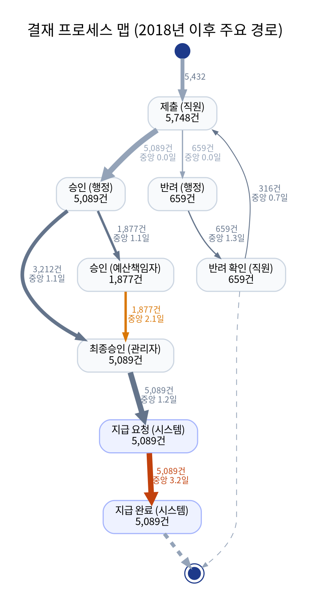
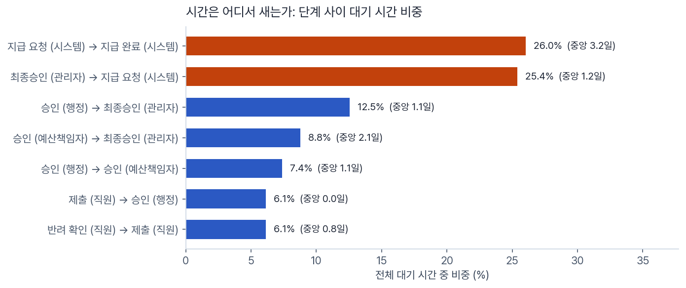
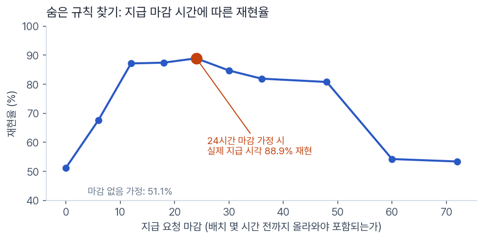
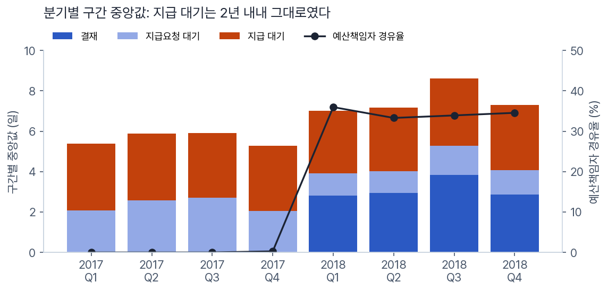
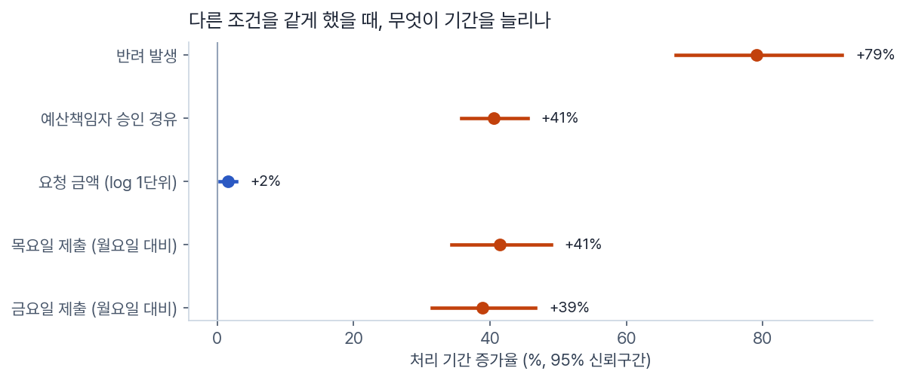
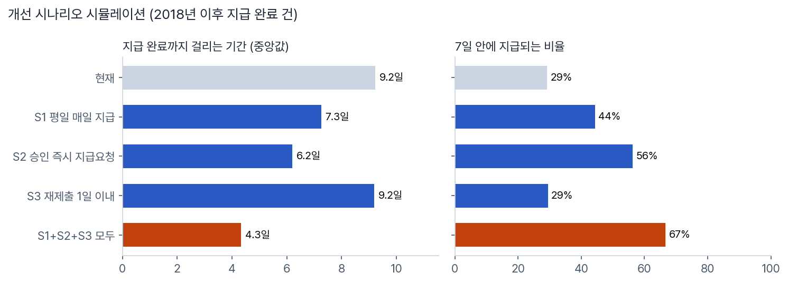

# 지급 요청 결재 프로세스 진단 (Process Mining)

실제 업무 시스템 로그로 결재 프로세스를 복원하고, **처리가 늦어지는 원인을 찾아 개선 효과를 시뮬레이션**한 프로세스 마이닝 프로젝트입니다.
데이터는 한 대학의 비용 지급 요청 6,886건, 이벤트 36,796개(BPI Challenge 2020, Request For Payment)입니다.

> **[분석 리포트 보기](https://sung-ju-park.github.io/projects/process-mining-report.html)** — 그림과 표가 모두 들어 있는 한 장짜리 리포트 · [프로젝트 소개](https://sung-ju-park.github.io/projects/process-mining.html)



## 한눈에 보기

| | |
|---|---|
| **질문** | 지급 요청은 왜 늦게 처리되는가, 무엇을 바꾸면 얼마나 빨라지는가 |
| **데이터** | 실제 업무 시스템 로그, 2017.01 \~ 2019.08, 분석 기준 2018년 이후 5,778건 |
| **방법** | 프로세스 발견, 단계별 대기 시간 분해, 숨은 규칙 추정, 통제 회귀분석, 규정 준수 점검, 시나리오 시뮬레이션 |
| **결론** | 지연의 절반은 결재가 끝난 뒤에 생긴다. 지급 규칙 두 가지를 바꾸고 반려 재제출을 줄이면 지급까지 중앙값 **9.2일 → 4.3일**, 7일 내 지급 **29% → 67%** |

## 핵심 발견

**1. 시간은 결재자가 아니라 결재가 끝난 뒤에 샌다**
단계 사이 대기 시간을 모두 더하면, "최종 승인 → 지급 요청"과 "지급 요청 → 지급 완료" 두 구간이 전체의 **51.9%**를 차지합니다.



**2. 지급은 월·목 17시에만, 그리고 숨은 24시간 마감이 있다**
지급 처리의 99.6%가 월요일과 목요일 17시에 몰려 있습니다. 그런데 "요청 후 다음 배치에 지급된다"고 가정하면 실제 지급 시각과 51.1%만 맞았습니다. 마감 시간을 0\~72시간으로 바꿔 가며 실제와 비교해, **배치 24시간 전까지 올라온 요청만 포함된다**는 규칙을 찾았고 이때 재현율은 **88.9%**입니다. 이 때문에 반려 없이 처리된 건 중 목요일 제출 건은 11.1일, 월요일 제출 건은 7.3일이 걸렸습니다.



**3. 예산책임자 승인을 거치면 결재가 3배 넘게 길어진다**
2018년부터 34%가 예산책임자 승인을 거칩니다. 같은 기간 안에서 비교하면 예산책임자를 거치는 건의 결재 구간은 1.7일 → 5.9일입니다. 2017년과의 비교는 결론에 쓰지 않았습니다. 2017년에는 제출과 최종 승인이 1분 안에 함께 기록된 건이 39%(2018년 0%)여서, 결재가 다른 방식으로 처리되고 기록만 한꺼번에 남았을 가능성이 크기 때문입니다.



**4. 반려 한 번이면 기간이 크게 늘고, 절반 가까이는 다시 제출되지 않는다**
15.9%가 반려를 겪고, 반려의 82%는 행정 단계에서 나옵니다. 반려된 건의 45%는 재제출 없이 끝났고, 조직별 반려율은 7%에서 31%까지 차이 납니다. 다른 조건을 통제한 회귀분석에서 반려는 처리 기간을 **+79%**, 예산책임자 경유는 **+41%** 늘렸고, 요청 금액의 영향은 거의 없었습니다(log 금액 1단위당 +1.6%).



**5. 통제는 잘 되고 있고, 문제는 속도다**
결재 규칙 6가지(최종 승인 없는 지급, 승인 전 지급 요청, 중복 지급 등)를 이벤트 순서로 점검한 결과, 2018년 이후 5,778건 중 위반은 5건(0.09%)이었습니다.

## 개선 시나리오

2번에서 재현율을 확인한 지급 규칙 위에서 규칙을 하나씩 바꿔, 2018년 이후 지급 완료 5,268건의 처리 기간을 다시 계산했습니다.



| 시나리오 | 중앙값 | 상위 10% | 7일 내 지급 |
|---|---|---|---|
| 현재 | 9.2일 | 23.0일 | 29% |
| S1 평일 매일 지급 | 7.3일 | 21.0일 | 44% |
| S2 승인 즉시 지급요청 | 6.2일 | 14.2일 | 56% |
| S3 재제출 1일 이내 | 9.2일 | 21.4일 | 29% |
| S1+S2+S3 모두 | 4.3일 | 12.2일 | 67% |

가장 효과가 큰 것은 **최종 승인 즉시 지급 요청을 자동 생성**하는 것(S2)입니다. 대기가 사라질 뿐 아니라 요청이 마감 전에 들어가 이번 배치에 포함되는 효과까지 생기고, 시스템 설정만으로 가능한 개선입니다.

## 분석 과정에서 내린 판단

| 상황 | 판단 |
|---|---|
| 2017년과 2018년의 처리 기간을 그대로 비교하면 2018년이 길다 | 2018년부터 대상 조직이 10개에서 36개로 늘었다. 같은 조직끼리 다시 비교했지만, 2017년에는 제출과 최종 승인이 1분 안에 함께 기록된 건이 39%(2018년 0%)라 기록 방식 차이가 섞여 있었다. 그래서 연도 비교는 결론에서 빼고, 2018년 안의 비교로만 결론을 냈다 |
| "다음 배치에 지급" 가정의 재현율이 51% | 이대로 시뮬레이션하면 숫자를 믿을 수 없다. 마감 시간을 변수로 두고 실제 지급 시각과 맞춰 24시간 마감 규칙을 찾은 뒤에 시나리오를 계산했다 |
| 자동 발견 모델(Inductive Miner)의 정밀도가 0.55 | 반려 루프 때문에 모델이 실제보다 넓은 경로를 허용한다. 노이즈 설정별로 비교해 기록하고, 결론은 실제 경로와 직접 계산한 맵을 근거로 냈다 |
| 회귀분석 설명력(R²)이 0.25 | 결재자 부재, 반려 사유 같은 정보가 로그에 없다. 개별 건 예측이 아니라 요인별 효과의 크기 비교로만 해석했다 |

모델 적합도 비교 (2018년 이후 로그)

| 노이즈 | 적합도 | 정밀도 | F1 |
|---|---|---|---|
| 0.0 | 1.000 | 0.412 | 0.584 |
| 0.1 | 0.987 | 0.515 | 0.677 |
| 0.2 | 0.982 | 0.554 | 0.709 |
| 0.3 | 0.982 | 0.554 | 0.709 |

## 구조

```
process-mining-payment-approval/
├─ src/
│  ├─ run_all.py       # 전체 실행
│  ├─ load.py          # XES 로그 → 이벤트·케이스 테이블, 케이스 결과 분류
│  ├─ discovery.py     # 변형 분석, 한글 프로세스 맵(Graphviz), Inductive Miner 적합도·정밀도
│  ├─ performance.py   # 단계별 대기 시간, 지급 배치 패턴, 분기별 구간 분해
│  ├─ rework.py        # 반려·재제출 분석, 조직별 반려율
│  ├─ conformance.py   # 결재 규칙 6가지 위반 점검
│  ├─ drivers.py       # 처리 기간 요인 회귀분석 (log 처리일수, 강건 표준오차)
│  ├─ whatif.py        # 지급 규칙 재현 검증 + 개선 시나리오 시뮬레이션
│  ├─ figures.py       # 그래프
│  └─ report.py        # 한 장짜리 HTML 리포트
├─ outputs/            # 리포트, 그래프, 결과(json, csv)
└─ data/raw/           # 원본 로그 (저장소에는 포함하지 않음)
```

## 재현 방법

```
pip install -r requirements.txt
# Graphviz 설치 필요 (프로세스 맵 생성)
# 4TU.ResearchData에서 BPI Challenge 2020의 RequestForPayment.xes.gz를 받아 data/raw/ 에 넣는다
python src/run_all.py
```

## 한계

- 로그에 반려 사유가 없어 반려 원인은 조직별 차이까지만 확인했습니다.
- 담당자가 익명화(STAFF MEMBER)되어 있어 사람별 업무량이나 부재의 영향은 볼 수 없습니다.
- 2017년 로그는 기록 방식이 달랐던 것으로 보여(제출·최종 승인 동시 기록 39%), 연도 간 비교는 결론에 쓰지 않았습니다.
- 시나리오는 재현율 88.9%의 지급 규칙 위에서 계산한 추정치입니다. 나머지는 공휴일 등 예외로 보입니다.

## 데이터

van Dongen, B.F. (2020). *BPI Challenge 2020: Request For Payment*. 4TU.ResearchData.
원본 로그는 저장소에 포함하지 않았고, 4TU.ResearchData에서 받을 수 있습니다. `outputs/`에는 집계 결과만 들어 있습니다.

## 만든 방식

분석 설계와 해석, 결과 검증은 직접 했고, 코드 구현은 ChatGPT·Claude와 함께 했습니다.
